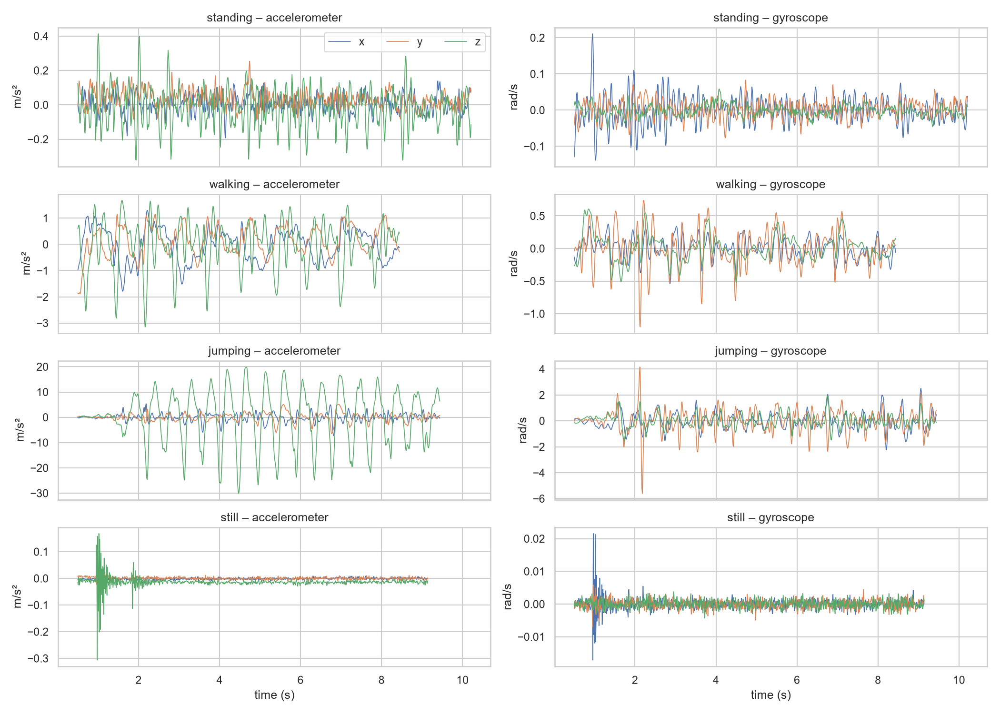
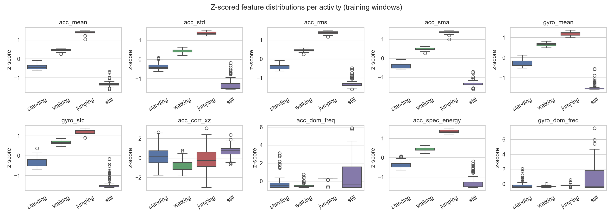
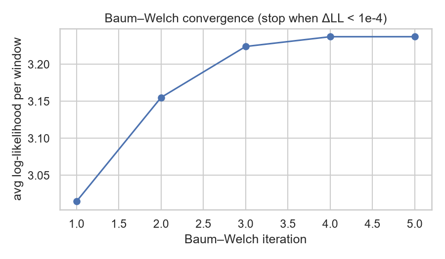
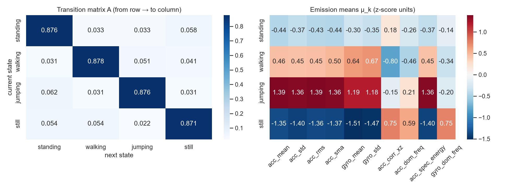
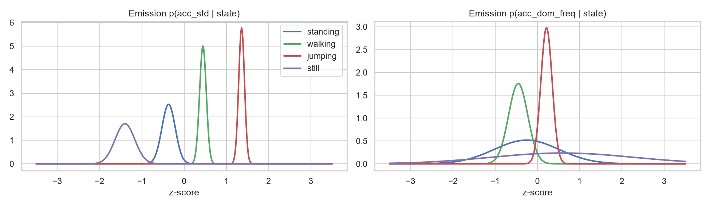
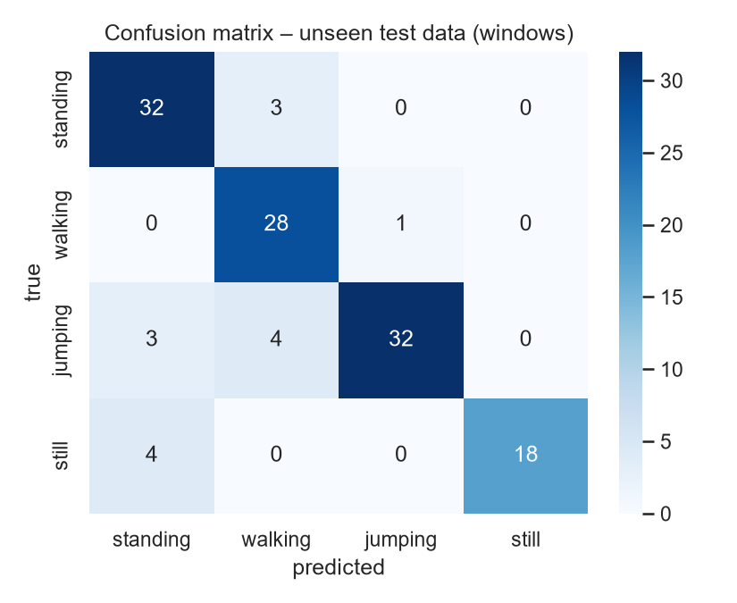
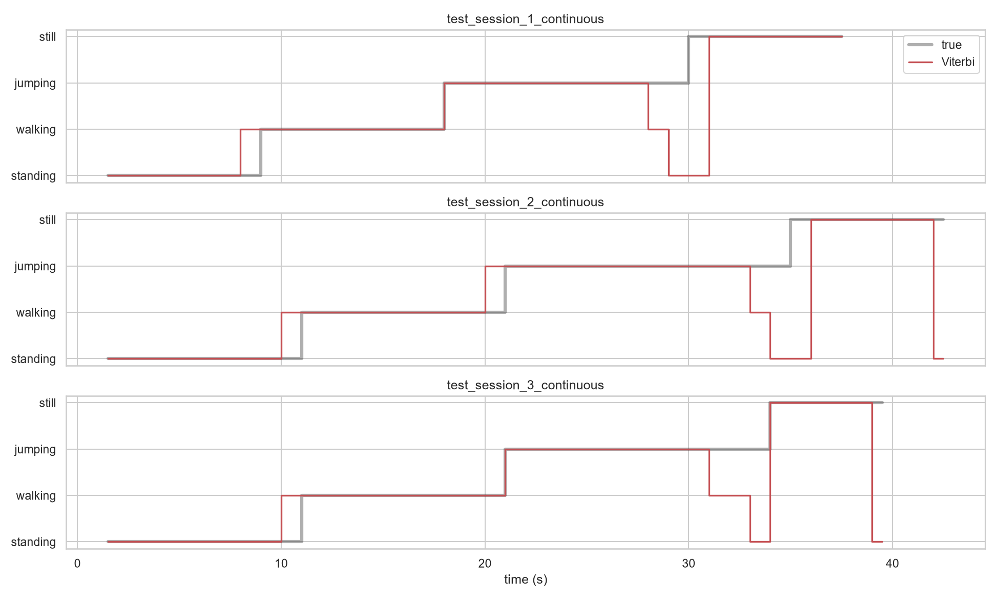

# Modeling Human Activity States Using Hidden Markov Models

**Student:** Samuel Kwizera Ihimbazwe  **Repository:** _[GitHub link]_

## 1. Background and Motivation

_[TODO: state your unique use case in one paragraph.]_ Example framing: a fall-risk and activity
monitor for elderly people living alone. It infers from a phone worn at the waist whether the person is
standing, walking, being vigorously active, or whether the phone has been left on a surface (still). The last
case matters most, because it means the person is no longer being monitored. Raw motion signals are noisy and the
true activity is never observed directly. It has to be inferred from a sequence of measurements, and activities
persist over time. A Hidden Markov Model fits this problem because it combines an emission model (what each
activity "looks like" in the sensors) with a transition model (how activities follow each other).

## 2. Data Collection and Pre-processing

**Device and app.** Sensor Logger (v1.68) on an iPhone X (iOS 16.7), accelerometer (gravity removed, m/s²) and
gyroscope (rad/s), held at waist level.

| Participant | Phone | Sampling rate |
|---|---|---|
| Samuel Kwizera Ihimbazwe | iPhone X | 100 Hz (10 ms) |

**Recordings.** 56 training clips, 14 per activity, recorded on 26 Oct 2026 (Kigali):

| Activity | Files | Total duration |
|---|---|---|
| Standing | 14 | 136.9 s |
| Walking | 14 | 115.9 s |
| Jumping | 14 | 116.7 s |
| Still (phone on table) | 14 | 116.3 s |

Every activity exceeds the 1 min 30 s minimum. Four further files were held out for testing (Section 5).

**Videos.** Standing: _[link]_ · Walking: _[link]_ · Jumping: _[link]_ · Still: _[link]_

**Cleaning** (`prepare_data.py`):
1. Accelerometer and gyroscope merged on their shared nanosecond timestamp; duplicates dropped.
2. 0.5 s trimmed from both ends to remove the screen tap that starts and stops logging.
3. **Sampling-rate harmonisation:** each file is linearly interpolated onto an exact 100 Hz grid. This removes
   iOS timestamp jitter, and a recording from a phone at a different rate (e.g. 50 Hz) would be mapped onto the same grid,
   so every window has an identical number of samples and identical FFT bins.
4. Files saved as `data/train/<activity>/<activity>_NN.csv` with a `timestamp` column and a `label` column.

**Windowing.** 2 s windows (200 samples at 100 Hz) with a 1 s hop (50 % overlap). Walking (~1.5–2 Hz) and
jumping (~2 Hz) are periodic, so a 2 s window holds 3–4 full cycles, enough for stable variance and a clear FFT
peak. The FFT resolution is fs/N = 0.5 Hz. A window also has to be short enough that transitions are localised to
about 1 s. This yields 399 training windows (standing 114, walking 94, jumping 95, still 96).

*Figure 1. Raw accelerometer and gyroscope signals for one clip of each activity.*

## 3. Feature Extraction and HMM Setup

Ten features per window are computed on the acceleration and angular-velocity magnitudes, which do not
depend on how the phone is oriented:

* **Time domain (7):** mean, standard deviation, RMS and signal magnitude area of acceleration (intensity:
  still < standing < walking < jumping); mean and std of gyroscope magnitude (hip rotation separates walking
  from standing); x–z acceleration correlation (axis coupling during periodic gait).
* **Frequency domain (3, FFT):** dominant frequency of acceleration (step or jump rate; random for still);
  spectral energy (non-DC power); dominant gyroscope frequency.

Intensity features span four orders of magnitude, so they are log-transformed to make them closer to Gaussian.
All features are then **Z-score normalised** with the mean and standard deviation of the training windows only,
reused unchanged on the test set. I chose Z-score over min–max because jumping spikes would dominate a min–max
range, and because Gaussian emissions are naturally expressed in standard-deviation units.

*Figure 2. Z-scored feature distributions per activity.*

| Component | Definition |
|---|---|
| Hidden states Z | standing, walking, jumping, still |
| Observations X | 10-dimensional normalised feature vector per window |
| Transitions A | 4×4, one step = 1 s |
| Emissions B | diagonal Gaussian per state |
| Initial π | probability of each starting activity |

**Algorithms.**
* **Viterbi** decodes the single most probable state sequence. I score this path against the labels, so it
  directly determines accuracy, sensitivity and specificity. Its transition prior suppresses one-window flickers,
  which raises specificity.
* **Baum–Welch** (EM with scaled forward–backward) re-estimates π, A, μ and σ² by maximising the likelihood of the
  data. It stops when the average log-likelihood changes by less than ε = 10⁻⁴, and converged after 5 iterations.
  To keep state identities fixed and avoid poor local optima, it is initialised from the labelled windows.
* The **forward algorithm** supplies the log-likelihood used in the convergence check.

Each clip contains only one activity, so the 56 clips were chained in a random order (seed 42) into 6 training
streams. A Dirichlet pseudo-count of 1 keeps every transition possible.

## 4. Results and Interpretation

*Figure 3. Baum–Welch log-likelihood per iteration.*

*Figure 4. Learned transition matrix (left) and emission means (right).*

*Figure 5. Gaussian emission densities for two key features.*

The diagonal of A is about 0.88, i.e. an expected stay of 1/(1−0.88) ≈ 8 s in each state. This matches my
~8–9 s clips, not real life (see Section 6). The emission means order the states by intensity exactly as expected.

## 5. Evaluation on Unseen Data

**Unseen data.** (a) Three continuous recordings of ~40 s each, made after the training session. Each performs
standing → walking → jumping → still back-to-back, so unlike the training data they contain real transitions.
Ground-truth segment boundaries were read from the video and the signal. (b) One standing recording made on
23 Oct 2026, a different day from the training session. None of these files were used for training or
normalisation.

| State (Activity) | Number of Samples (windows) | Sensitivity | Specificity | Overall Accuracy |
|---|---|---|---|---|
| Standing | 35 | 0.914 | 0.922 | 0.880 |
| Walking | 29 | 0.966 | 0.927 | 0.880 |
| Jumping | 39 | 0.821 | 0.988 | 0.880 |
| Still | 22 | 0.818 | 1.000 | 0.880 |

Per file: session 1 = 0.892, session 2 = 0.857, session 3 = 0.872, different-day standing = 1.000. The
supervised-only model (before Baum–Welch) reached 0.912.

*Figure 6. Confusion matrix on unseen data.*

*Figure 7. True (grey) vs Viterbi-decoded (red) activity for the three continuous sessions.*

The model generalises well. Every activity segment in every session is found in the right order, and all errors
lie within ~2–3 s of an activity boundary.

## 6. Discussion and Conclusion

**Easiest and hardest.** Walking (sensitivity 0.97) and still (specificity 1.00) are easiest. Still has
near-zero energy and nothing else does, and walking has a distinctive ~1.7 Hz rhythm with strong hip rotation.
Jumping (0.82) and still (0.82) have the lowest sensitivity, and the reason is mostly labelling, not the model.
At the end of each jumping bout the model decodes jumping → walking → standing → still. That is what physically
happened: I slowed down, walked to the table and put the phone down. My ground truth called that whole
stretch "jumping". In the same way, windows where the phone is being picked up are labelled still but look like
standing.

**Transition probabilities.** A strongly favours staying in the current state (≈0.88), which is realistic:
activities persist for many seconds. The off-diagonal values are almost uniform because the training clips were
chained randomly. In real behaviour some transitions are rare (still → jumping requires picking the phone up
first), and real activity bouts last minutes, not 8 s, so the self-transitions would be closer to 0.98.
Learning A from long, natural recordings would make it more realistic.

**Noise and sampling rate.** Even standing produces small tremor and sway signals (~0.1 m/s²), which is what
separates it from still. At 100 Hz the Nyquist limit (50 Hz) is far above every human-motion frequency
(< 5 Hz), so the rate was never limiting. 25–50 Hz would suffice and save battery. In the still state the
dominant-frequency features are pure noise, which Baum–Welch represents with a wide variance. Baum–Welch
improved training likelihood but lowered test accuracy from 0.912 to 0.880. EM maximises likelihood, not
classification accuracy, and it widened the state variances to absorb boundary windows.

**Improvements.** More participants (a single person recorded all data here) and phones (and phone placements, e.g. pocket vs hand); longer natural
sessions to learn realistic transitions; sample-accurate boundary labels; full-covariance or Gaussian-mixture
emissions; additional features (step-band energy ratio, jerk) or sensors (barometer for jump height,
magnetometer); and a hierarchical or semi-Markov model with explicit state durations.

**Conclusion.** A from-scratch Gaussian HMM with 10 time- and frequency-domain features, trained with
Baum–Welch and decoded with Viterbi, recognises four activities on unseen recordings with 88 % accuracy
(91 % with supervised parameters). Nearly all errors sit at activity transitions.
